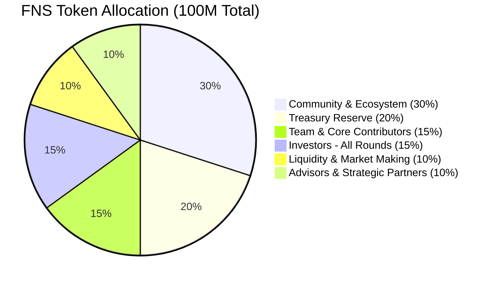

# FNS Token — Tokenomics & Governance

> **Mainnet Feature Plan** — This describes FNS tokenomics and governance functionality planned for mainnet launch. Not yet implemented.

---

## FNS Token Overview

FNS is the governance and value-capture token of the FENUS protocol. It gives holders control over economic and risk parameters without touching the immutable core contracts.

### Token Details

| Property | Value |
|----------|-------|
| Name | FENUS |
| Symbol | FNS |
| Total Supply | 100,000,000 (fixed, no inflation) |
| Chain | LitVM |
| Standard | ERC-20 with ERC20Votes |

### Token Allocation

| Allocation | % | Tokens |
|------------|---|--------|
| **Community & Ecosystem** | 30% | 30,000,000 |
| **Treasury Reserve** | 20% | 20,000,000 |
| **Team & Core Contributors** | 15% | 15,000,000 |
| **Investors (All Rounds)** | 15% | 15,000,000 |
| **Liquidity & Market Making** | 10% | 10,000,000 |
| **Advisors & Strategic Partners** | 10% | 10,000,000 |
| **Total** | **100%** | **100,000,000** |

### Key Notes

- No airdrops
- No staking rewards emissions — stakers earn from **liquidation penalties only**
- Fixed supply — no inflation, ever

### Value Capture

FNS captures value through:

- **Staking** — stakers earn a share of liquidation penalties directly (not FNS emissions)
- **Buy & burn** — a portion of surplus can be allocated to buying and burning FNS
- **Governance power** — control over risk parameters, collateral listings, and treasury spending

---

## Governance — Core Principle

FNS holders control the **economic and risk parameters** of the FENUS protocol. They do **not** control the core smart contract logic (which is immutable) or the founders' fees on opening/closing Troves.

---

## What Governance Can Do

### 1. Collateral Asset Management

| Action | What They Vote On | Example |
|--------|-------------------|---------|
| **Add new asset** | Whitelist a new tokenized stock or crypto | Vote to add bTSLA (Backed Tesla) |
| **Remove asset** | De-whitelist an asset that becomes risky | Vote to remove an equity token with broken peg |
| **Set MCR** | Minimum Collateral Ratio per asset | zkLTC = 135%, TSLA = 180%, AAPL = 150% |
| **Set interest rate range** | Min/max APR borrowers can choose | TSLA: 3%-8%, zkLTC: 0%-5% |
| **Set debt ceiling** | Max total borrowing per asset | Cap TSLA borrowing at $5M total |

### 2. Risk Parameters

| Action | What They Vote On | Example |
|--------|-------------------|---------|
| **Liquidation penalty** | % penalty applied during liquidation | Raise from 5% to 7% during high volatility |
| **Redemption fee** | Fee for redeeming FnUSD for collateral | Lower from 0.5% to 0.25% to encourage peg defense |
| **Liquidation threshold buffer** | How far below MCR triggers liquidation | Set to 2% buffer (liquidate at 133% instead of 135%) |

### 3. Surplus & Treasury Allocation

| Action | What They Vote On | Example |
|--------|-------------------|---------|
| **Surplus distribution** | Where liquidation surplus goes | 50% to treasury, 30% to stakers, 20% to buy & burn |
| **Fee allocation** | How borrowing/swap fees are used | 40% to treasury, 60% to staking rewards |
| **Grants** | Fund other LitVM projects | Allocate 500k FNS to a LitVM DEX integration |
| **LP incentives** | FNS emissions to liquidity providers | Boost FNS rewards for FnUSD/zkLTC pool |

### 4. Staking Parameters

| Action | What They Vote On | Example |
|--------|-------------------|---------|
| **Staking rewards split** | % of penalties to stakers vs. treasury | 80% to stakers, 20% to treasury |

---

## How a Proposal Becomes Reality

### Step 1: Submit Proposal

Any FNS holder (or delegate) submits a formal proposal onchain. Must include:

- **Title** — e.g., "Add bTSLA as collateral with 180% MCR"
- **Description** — rationale, risk assessment, expected impact
- **Calldata** — the exact function calls to the Registrar contract
- **Voting period** — e.g., 7 days

### Step 2: Discussion Period (3-5 days)

Proposal is discussed on the FENUS governance forum. Changes can be made before voting starts.

### Step 3: Voting (5-7 days)

FNS holders vote:

- **For** — yes, execute this change
- **Against** — no, reject this change
- **Abstain** — not enough information, but quorum still counts

**Quorum requirement:** 4% of total FNS supply must vote for the result to be valid.

### Step 4: Timelock (2-3 days)

If the proposal passes, the change is queued in a **Timelock contract**. This delay allows:

- Users to withdraw funds if they disagree with the change
- Teams to verify the change is correct
- Emergency veto by multi-sig (rarely used)

### Step 5: Execution

After the timelock expires, anyone can execute the proposal. The Registrar contract updates its parameters. Core CDP contracts now enforce the new rule — without any upgrade.

---

## Example: Add bTSLA as Collateral

**Proposal text:**

> "Add Backed TSLA (bTSLA) as collateral. bTSLA is a tokenized Tesla stock, fully backed and regulated. Proposed parameters: MCR = 180%, interest range = 3-8%, debt ceiling = $2M. Oracle: Chainlink TSLA/USD on LitVM."

**Vote result:** 15M FNS For, 2M Against, 1M Abstain — passes.

**Timelock:** 48 hours.

**Execution:** Registrar adds bTSLA. Users can now deposit bTSLA and mint FnUSD.

---

## What Governance Cannot Change (Fixed Forever)

| Item | Why |
|------|-----|
| Core CDP contract logic | Immutable — no upgrades, no admin keys |
| Opening/closing Trove fees | Founders' revenue — not subject to vote |
| Total FNS supply (100M) | Fixed — no inflation, ever |
| Base liquidation mechanism | Core safety — not up for debate |
| FNS staking contract (rewards logic) | Fixed — only penalty % is adjustable |

---

## Governance Infrastructure (Planned)

| Component | Purpose |
|-----------|---------|
| **Snapshot** | Offchain voting (gasless, signaling) |
| **Tally** | Onchain voting + proposal execution |
| **Timelock contract** | Delays execution by 2-3 days |
| **Registrar contract** | Stores all governable parameters |
| **Governor contract** | Manages proposals, votes, quorum |
| **Discourse / Commonwealth** | Discussion forum |

---

## Summary

FNS holders control collateral assets, risk parameters, treasury allocation, and surplus distribution — but core contract logic and founder fees remain fixed.
